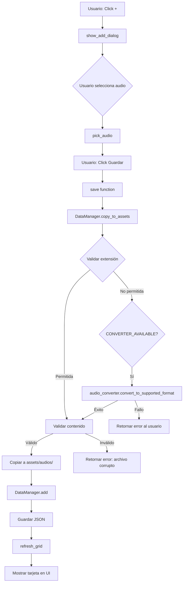
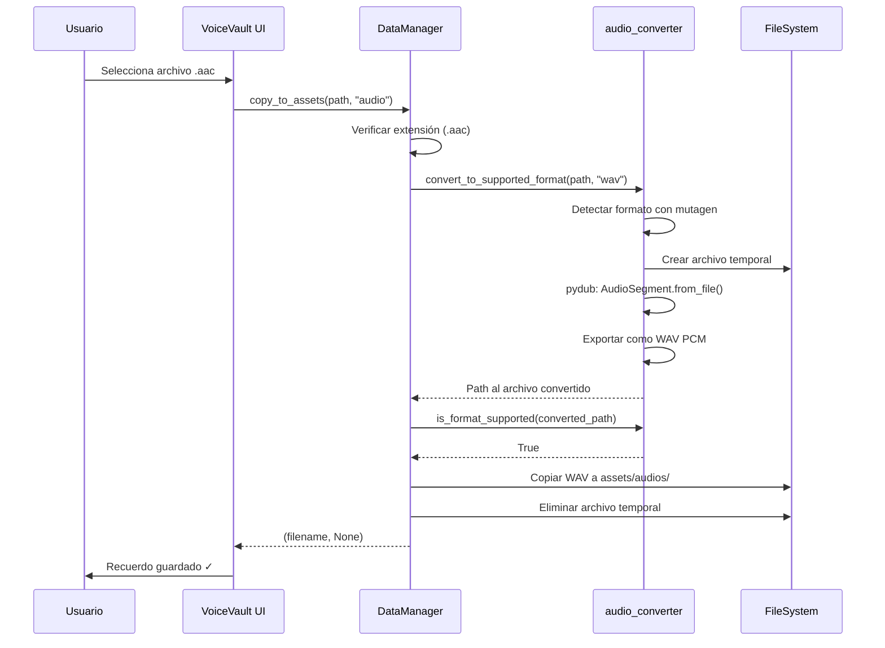

# VoiceVault - Arquitectura del Sistema

> **Documento de Arquitectura (SSoT - Single Source of Truth)**  
> Última actualización: 2026-02-17  
> Versión: 2.0 (Post-Auditoría)

## Resumen Ejecutivo

VoiceVault es una aplicación de escritorio Python para preservar memorias de audio con fotografías, categorización y funciones de reproducción avanzadas. Este documento define la arquitectura, patrones y convenciones que deben seguirse para mantener la integridad del sistema.

## Principios Arquitectónicos

### 1. **Seguridad Primero**
- **Validación de contenido**, no solo extensiones de archivo
- **Logging estructurado** para auditoría y debugging
- **Manejo de errores robusto** con recuperación cuando sea posible

### 2. **Type Safety**
- Uso de **type hints** en todo código nuevo
- Uso de `pathlib.Path` para manipulación de rutas
- Estructuras de datos tipadas cuando sea posible

### 3. **Separación de Responsabilidades**
- Módulos especializados por función
- Evitar acoplamiento tight entre componentes
- Interfaces claras entre capas

## Stack Tecnológico

### Core
- **Python**: 3.8+
- **UI Framework**: CustomTkinter 5.2+
- **Audio Playback**: pygame 2.5+
- **Image Processing**: Pillow 10.0+

### Audio Processing
- **Recording**: sounddevice 0.4.6+, soundfile 0.12.1+
- **Metadata**: mutagen 1.47+
- **Conversion**: pydub 0.25.1+ (requiere ffmpeg)
- **Waveform Generation**: Custom (Pillow + numpy)

### Persistence
- **Format**: JSON
- **Location**: `data/voicevault.json`
- **Assets**: `assets/photos/`, `assets/audios/`

## Estructura de Directorios

```
VoiceVault/
├── main.py                    # Aplicación principal (UI + lógica)
├── audio_utils.py             # Grabación y waveforms
├── audio_converter.py         # [NUEVO] Conversión y validación de formatos
├── requirements.txt           # Dependencias Python
├── voicevault.log            # [NUEVO] Log estructurado
├── .env.example              # [FUTURO] Configuración externa
│
├── assets/
│   ├── photos/               # Fotos de recuerdos (UUID)
│   ├── audios/               # Archivos de audio (UUID)
│   ├── waveforms/            # Waveforms generados (PNG)
│   ├── Categorias/           # Iconos de categorías
│   ├── LogoVoiceVault.png
│   ├── app_icon.png
│   └── [otros recursos]
│
├── data/
│   └── voicevault.json       # Base de datos de recuerdos
│
└── [directorio del proyecto]/
    ├── ARCH.md               # Este archivo
    ├── AUDIT_REPORT.md       # Reporte de auditoría
    └── README.md             # Documentación de usuario
```

## Arquitectura de Componentes

### 1. **main.py** - Aplicación Principal

**Responsabilidades**:
- Interfaz gráfica (CustomTkinter)
- Gestión de estado de aplicación
- Control de reproducción (playlist, shuffle)
- Diálogos de usuario

**Clases Principales**:
- `VoiceVault`: Ventana principal y orquestación
- `DataManager`: Persistencia y gestión de datos
- `Colors`: Paleta de colores (diseño system)
- `ToolTip`: Tooltips UI

**Convenciones**:
- Usar logging estructurado: `logger.info()`, `logger.error()`
- NO usar `print()` para debugging
- Manejo de errores con try-except específicos

### 2. **audio_converter.py** - Conversión de Audio

**Responsabilidades**:
- Detectar formato real de archivos de audio (no solo extensión)
- Convertir formatos no soportados a formatos compatibles
- Validar integridad de archivos de audio

**Funciones Principales**:
```python
detect_audio_format(file_path: Path) -> Optional[AudioFormat]
is_format_supported(file_path: Path) -> bool
convert_to_supported_format(source: Path, target_format: str) -> Optional[Path]
get_conversion_capabilities() -> Dict[str, bool]
```

**Formatos Soportados Nativamente**:
- `.mp3` - MPEG Audio Layer 3
- `.wav` - Waveform Audio File Format (PCM)
- `.ogg` - Ogg Vorbis
- `.flac` - Free Lossless Audio Codec

**Formatos Convertibles** (requiere ffmpeg):
- `.m4a`, `.aac`, `.wma`, `.opus`, `.aiff`, `.ape`, `.mpc`, `.webm`, `.3gp`

**Seguridad**:
- **Validación triple**: mutagen → soundfile → pydub
- **Conversión en sandbox**: Archivos temporales en `tempfile`
- **Limpieza automática**: Archivos temporales eliminados después de conversión

### 3. **audio_utils.py** - Utilidades de Audio

**Responsabilidades**:
- Grabación de audio desde micrófono
- Generación de waveforms visuales
- Selección de dispositivos de entrada

**Clases/Funciones**:
```python
class AudioRecorder:
    get_devices() -> List[Dict]
    start_recording(device_id: Optional[int]) -> None
    stop_recording() -> Optional[str]

def generate_waveform(audio_path: str, output_path: str, ...) -> bool
```

## Flujo de Datos

### Creación de Recuerdo (Happy Path)



### Conversión Automática (Detalle)



## Patrones de Diseño

### 1. **Validación en Capas**
Para archivos de audio:
1. **Extensión** (rápido, primera línea de defensa)
2. **Conversión** (si no es compatible, convertir automáticamente)
3. **Contenido** (validar que sea audio real con mutagen/soundfile)
4. **Copia** (si todo pasa, copiar a assets)

### 2. **Error Handling**
```python
try:
    # Operación específica
    result = risky_operation()
except SpecificException as e:
    logger.error(f"Operation failed: {e}")
    return None, "Mensaje amigable para usuario"
```

**NO hacer**:
```python
try:
    # ...
except Exception as e:
    print(f"Error: {e}")  # ❌ Sin logging, sin mensaje al usuario
```

### 3. **Logging Estructurado**
```python
logger.info(f"Converting {filename} from {ext} to WAV")
logger.warning(f"ffmpeg not available - conversion disabled")
logger.error(f"Validation failed for {filename}: {reason}")
logger.debug(f"Temporary file created at {temp_path}")
```

### 4. **Type Safety**
```python
def process_file(path: Path, options: Dict[str, Any]) -> Tuple[Optional[str], Optional[str]]:
    """
    Procesa archivo con opciones.
    
    Returns:
        (result, error_message): result si éxito, error_message si falla
    """
```

## Convenciones de Código

### Nombrado
- **Variables**: `snake_case`
- **Constantes**: `UPPER_SNAKE_CASE`
- **Clases**: `PascalCase`
- **Funciones privadas**: `_leading_underscore`

### Documentación
- **Docstrings**: Formato Google Style
- **Type hints**: Obligatorio para funciones públicas
- **Comentarios**: Solo cuando la lógica no sea obvia

### Imports
```python
# Standard library
import os
import logging
from pathlib import Path

# Third-party
import customtkinter as ctk
import pygame

# Local
from audio_utils import AudioRecorder
import audio_converter
```

## Gestión de Errores

### Categorías de Errores

| Categoría | Nivel de Log | Acción |
|-----------|--------------|--------|
| Archivo no encontrado | `ERROR` | Mostrar error al usuario |
| Formato no soportado | `WARNING` | Intentar conversión automática |
| Conversión fallida | `ERROR` | Mostrar error con detalles |
| ffmpeg no disponible | `WARNING` | Mostrar instrucciones de instalación |
| Archivo corrupto | `ERROR` | Rechazar archivo |
| Error de copia | `ERROR` | Mostrar error al usuario |

### Mensajes al Usuario

**Principios**:
1. **Claro y accionable**: Decir qué salió mal y qué hacer
2. **No técnico**: Evitar jerga ("corrupto" > "invalid magic bytes")
3. **Específico**: No usar "Error genérico"

**Ejemplos**:
- ✅ "FFmpeg no está instalado. Se requiere para convertir este formato."
- ✅ "El archivo no contiene audio válido o está corrupto"
- ❌ "Exception in thread main"
- ❌ "Error"

## Configuración del Sistema

### Variables de Entorno (Futuro)

Aunque actualmente no se usan, el sistema está preparado para:

```env
LOG_LEVEL=INFO              # DEBUG, INFO, WARNING, ERROR
MAX_AUDIO_SIZE_MB=100       # Límite de tamaño de archivo
AUTO_CONVERT_AUDIO=true     # Conversión automática
DEFAULT_CONVERSION_FORMAT=wav  # wav, mp3, ogg
```

### Constantes Configurables

En `main.py`:
```python
ALLOWED_AUDIO = (".mp3", ".wav", ".m4a", ".ogg", ".flac")
ALLOWED_IMAGE = (".jpg", ".jpeg", ".png", ".webp", ".gif")
CATEGORIES = ["Familiares", "Amigos", "Especiales"]
```

## Dependencias Externas

### ffmpeg (Crítico para Conversión)

**Instalación**:
- **Windows**: Descargar de https://www.gyan.dev/ffmpeg/builds/, agregar a PATH
- **macOS**: `brew install ffmpeg`
- **Linux**: `sudo apt-get install ffmpeg` (Debian/Ubuntu)

**Verificación**:
```python
from pydub.utils import which
ffmpeg_available = which("ffmpeg") is not None
```

## Limitaciones Conocidas

1. **Archivo Monolítico**: `main.py` tiene 2400+ líneas (deuda técnica)
   - **Mitigación futura**: Separar UI, DataManager, Playlist en módulos
   
2. **Sin Tests Automatizados**: No hay suite de pruebas
   - **Mitigación**: Logging extensivo para debugging

3. **Persistencia JSON**: No es escalable para miles de recuerdos
   - **Mitigación futura**: Migrar a SQLite

4. **Conversión Bloqueante**: UI se congela durante conversión
   - **Mitigación futura**: Threading o async para conversiones

## Roadmap de Mejoras

### Corto Plazo (Implementado)
- [x] Validación de contenido de archivos
- [x] Conversión automática de formatos
- [x] Logging estructurado
- [x] Mensajes de error descriptivos

### Mediano Plazo (Pendiente)
- [ ] Separar `main.py` en módulos (UI, DataManager, Playlist)
- [ ] Tests automatizados con pytest
- [ ] Conversión asíncrona (threading)
- [ ] Configuración externa con .env

### Largo Plazo (Futuro)
- [ ] Migración a SQLite para persistencia
- [ ] API REST para integración con otras apps
- [ ] Sincronización en la nube (opcional)
- [ ] Aplicación móvil complementaria

## Contacto y Mantenimiento

**Autor**: @urielovolt  
**Repositorio**: [VoiceVault en GitHub](https://github.com/urielovolt/VoiceVault)  
**Licencia**: MIT

---

> **Nota**: Este documento es el **Single Source of Truth** para la arquitectura de VoiceVault. Cualquier cambio arquitectónico debe reflejarse aquí primero.
